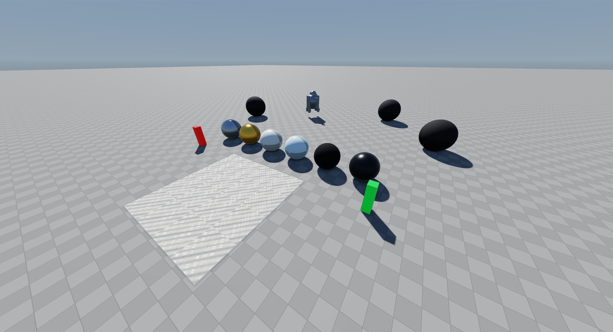
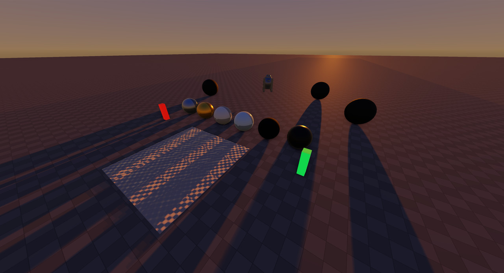
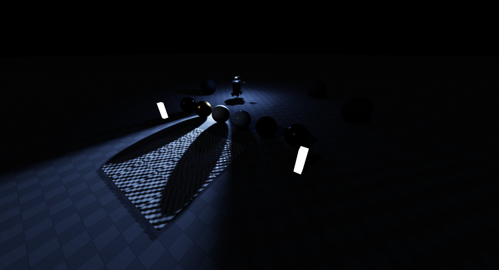

# pybullet_pbr

A physically based renderer for PyBullet, in PyBullet's own window and in its offscreen
cameras. No external process, no frame streaming, and your installed PyBullet is left
untouched.







The same scene under `earth_day`, `earth_sunset` and `moon_psr` — one call apart. The
last one is lit only by the lamps the robot carries.

```python
import pybullet_pbr
pybullet_pbr.activate()

import pybullet as p          # unchanged from here on
p.connect(p.GUI)
```

Everything else in your simulation stays as it was: physics, URDF loading, stepping,
camera control and `getCameraImage()` all behave exactly as before.

## What it adds

| | PyBullet | pybullet_pbr |
|---|---|---|
| Shading | Blinn-Phong | Cook-Torrance: GGX, Smith, Schlick, metallic/roughness |
| Colour | shading in sRGB | linear throughout, HDR, ACES tone mapping |
| Lighting units | arbitrary | lux, lumens, kelvin, and photographic exposure |
| Environment | flat background colour | image-based lighting from a sky or an HDR file |
| Shadows | one hard map | PCF, slope-scaled bias, penumbra from the sun's angular size |
| Extra lights | none | point and spot lights that move, attach to robots, and cast shadows |
| Materials | colour + specular | metallic/roughness, emissive, normal/roughness/metallic/AO maps |
| Screen space | none | SSAO, FXAA, TAA, bloom, vignette, sensor noise, motion blur, auto-exposure |
| Offscreen | TinyRenderer | the same PBR pipeline, headless through EGL |

## Install

Linux, OpenGL 3.3+, a C++ compiler, and the Python, GL and X11 development headers.

```bash
git clone <your-repo-url> pybullet-pbr && cd pybullet-pbr
./build.sh
```

`build.sh` fetches the Bullet source, applies a small patch to it, and builds a local
`pybullet` extension into `build/`. It never uses `sudo`, never installs anything outside
the project, and never touches an installed PyBullet. `./clean.sh` removes the build
output.

## Use it in an existing project

Two lines at the top of your entry point, before anything imports pybullet:

```python
import pybullet_pbr
pybullet_pbr.activate()

import pybullet as p
```

Then, wherever you build your scene:

```python
pybullet_pbr.set_scene("moon_polar")
pybullet_pbr.set_material(rover, link=None, preset="aluminium")
pybullet_pbr.set_material(terrain, preset="lunar_regolith")
```

`example_robotics.py` is a complete worked example.

### Headless

```python
p.connect(p.DIRECT)
pybullet_pbr.enable_headless()      # after connect, before rendering

w, h, rgb, depth, seg = p.getCameraImage(640, 480, view, proj,
                                         renderer=p.ER_BULLET_HARDWARE_OPENGL)
```

Offscreen images then come from the same pipeline as the viewport, with no window and no
display at all. Without it, `p.DIRECT` uses PyBullet's software renderer. Needs a GPU
reachable through EGL, which on a headless server usually means NVIDIA's libEGL.

## Showcase

```bash
python3 showcase.py                # interactive tour, driven from the keyboard
python3 showcase.py moon_psr       # start in a particular scene
python3 showcase.py --shots        # render the whole tour to build/showcase/
python3 showcase.py --list         # scenes and materials
```

One scene with a row of materials, a normal-mapped slab, glowing markers, rocks and a
robot driving a circle with its own headlamp. Keys switch scene, lights, exposure,
anti-aliasing, ambient occlusion, bloom, vignette, noise, motion blur, material maps and
the debug views, so you can see each thing turn on and off against the same frame.

## Lighting scenarios

```python
pybullet_pbr.set_scene("mars_day")
pybullet_pbr.set_scene("moon_polar", sun_elevation=1.5)   # any field can be overridden
pybullet_pbr.scene_names()
```

| Scene | |
|---|---|
| `earth_noon` | overhead sun, short hard shadows, bright blue sky |
| `earth_day` | mid-morning daylight; the general-purpose outdoor default |
| `earth_sunset` | low warm sun, very long shadows, orange horizon |
| `earth_night` | moonlit: 0.25 lux, deep blue sky, the camera working at EV −1 |
| `earth_indoor` | closed environment lit to office levels, soft and even |
| `moon_equatorial` | high sun, black sky, brutal contrast |
| `moon_aristarchus` | Aristarchus Plateau (23.7°N, 47.4°W): mid-latitude sun, bright plateau |
| `moon_polar` | grazing sun, extremely long shadows against a black sky |
| `moon_psr` | permanently shadowed region: no direct sun, only faint secondary light |
| `mars_day` | butterscotch dusty sky, weaker sun, dust-filled shadows |
| `mars_dusty` | dust storm: sun heavily attenuated, light becomes almost ambient |
| `mars_sunset` | dust scatters red forward, so the sky near the sun goes blue |

Each sets sun direction, illuminance in lux and colour temperature, sky luminance in
cd/m², indirect-light strength, camera EV and shadow softness. Earth's midday sun is
100 000 lux, the Moon's 128 000 (no atmosphere to absorb it), Mars' 55 000 (2.3× further
out), a full moon 0.25. A scene's EV is metered for the light that actually reaches a
horizontal surface — the beam illuminance times the sine of the sun's elevation — while
scenes meant to read dark are deliberately left under that.

## Materials

```python
pybullet_pbr.set_material(body, preset="lunar_regolith")
pybullet_pbr.set_material(robot, link=None, preset="aluminium")   # base and every link
pybullet_pbr.set_material(body, preset="ice", roughness=0.3)      # override a field
pybullet_pbr.set_material(marker, base_color=[0.2, 1, 0.4, 1], emissive=3000)  # cd/m²
pybullet_pbr.clear_material(body)
pybullet_pbr.material_names()
```

`aluminium` `steel` `metal_polished` `metal_brushed` `gold_foil` `copper` `plastic_white`
`plastic_black` `rubber` `carbon_fiber` `solar_panel` `lunar_regolith` `lunar_highland`
`lunar_bright` `lunar_pyroclastic` `mars_regolith` `rock_basalt` `rock_light` `sand`
`concrete` `ice` `water` `snow`

Reflectances match the real substance: lunar mare regolith 9%, highland 16%, fresh
Aristarchus-class ejecta 26%, pyroclastic mantle 7%, Martian soil 25% in red falling to
6% in blue, concrete 26%. These are given as **sRGB base colours**, which is the encoded
form — 9% reflectance is 0.33 in sRGB, not 0.09.

Materials are per graphics *instance*, so two bodies built from one shared collision
shape can carry different materials.

### Material maps

```python
pybullet_pbr.set_material(rock, preset="rock_basalt",
                          normal_texture="rock_normal.png",
                          roughness_texture="rock_rough.png",
                          ao_texture="rock_ao.png")
pybullet_pbr.set_normal_scale(1.0)
```

Any image works; the ones in `assets/textures` are only defaults. Roughness, metallic and
AO maps *multiply* the material's values. Normal maps derive their tangent frame per
pixel, so meshes need no tangent attribute and geometry without usable UVs falls back to
its plain geometric normal — a normal map is only as good as the UVs under it, and
Bullet's built-in primitives have poor ones.

Base colour multiplies any texture already on the shape, so a ground preset applied over
PyBullet's checkerboard plane renders at roughly half the albedo it names — that pattern
averages about 0.6. `assets/textures/scale_grid.png` keeps a pattern for judging distance
and object size while averaging 0.95:

```python
pybullet_pbr.set_material(terrain, preset="lunar_regolith",
                          base_color_texture="assets/textures/scale_grid.png")
pybullet_pbr.set_material(terrain, preset="concrete", base_color_texture=False)  # none
```

Maps apply per registered graphics *shape*, as PyBullet's own base-colour texture does.

## Lights

```python
lamp = pybullet_pbr.add_spot_light(lumens=4000, kelvin=6000, cone_angle=50,
                                   cone_softness=0.35, radius=0.04, range=25)
pybullet_pbr.attach_light(lamp, robot, link=-1,
                          offset=[0.45, 0, 0.35], direction=[1, 0, -0.22])

beacon = pybullet_pbr.add_point_light(position=[0, 0, 2], lumens=800, kelvin=2700)

while True:
    p.stepSimulation()
    pybullet_pbr.sync_lights()      # keeps attached lights on their body
```

| | |
|---|---|
| `lumens` | luminous flux. Car headlight ~1200, 60 W bulb ~800, work floodlight ~10000. Or give `candela`. |
| `kelvin` | 1800 candle, 2700 warm white, 4000 neutral, 5500 daylight, 6500 overcast. A lamp renders neutral when its temperature matches the camera's white balance. |
| `radius` | emitter size in metres — drives shadow softness *and* highlight size. |
| `cone_angle` | full outer angle of a spot, in degrees. `cone_softness` 0 is hard-edged, 1 fades from the centre. |
| `yaw` / `pitch` | aim in degrees; yaw 0 is +X, pitch −90 straight down. Or give `direction`. |
| `range` | metres past which the light is cut off. |

Also `move_light`, `aim_light`, `look_at`, `update_light`, `remove_light`,
`clear_lights`, `get_light`, `detach_light`, `set_light_shadow_bias`.

`offset` and `direction` in `attach_light` are in the link's local frame, so they rotate
with the robot. There are 8 light slots and a 16-tile shadow atlas: a spot costs one
tile, a point light six. `shadows=False` costs no tiles.

## Camera

The renderer works in real photometric units, so exposure is photographic too.

```python
pybullet_pbr.set_camera_exposure(aperture=16, shutter=1/125, iso=100)   # sunny 16
pybullet_pbr.set_ev(14.7)
pybullet_pbr.set_auto_exposure(True, key=0.18, min_ev=-6, max_ev=20)
pybullet_pbr.set_white_balance(kelvin=5500)
pybullet_pbr.set_sensor(bloom=1.0, vignette=0.4, noise=0.15, motion_blur=0.5)

from pybullet_pbr import photometry
photometry.ev_for_illuminance(500)          # 7.05, correct EV for an office
photometry.ev_for_light(4000, distance=5)   # expose for your own headlight
```

Reference EVs: 15 direct sun, 12 overcast, 9 bright room, 3 candlelit, −1 full moon.

Auto-exposure meters the whole frame, so a small very bright source in shot pulls the
exposure down, as a camera without spot metering would. Metering is instantaneous: there
is no adaptation delay yet.

White balance defaults to a camera's daylight preset (5500 K). Because the lights are
physical, a 5500 K sun really is warmer than sRGB's 6500 K white point, and a camera
cancels that by dividing through the colour of the illuminant it is balanced for. Scenes
use a fixed daylight balance rather than balancing to their own sun — dividing a 2000 K
key light out of a sunset leaves only the blue sky fill, so the golden hour would come
out blue. Airless scenes balance to their own sun, having no sky fill to preserve.

## Environment, shadows, ambient occlusion, anti-aliasing

```python
pybullet_pbr.set_environment()                            # procedural sky (default)
pybullet_pbr.set_environment("studio.hdr", strength=0.4)  # equirectangular HDR
pybullet_pbr.set_environment(None)                        # no indirect light

pybullet_pbr.set_sun_direction(elevation=32, azimuth=180)
pybullet_pbr.set_sun_angular_diameter(0.53)   # 0.53 from Earth and the Moon, 0.35 Mars
pybullet_pbr.set_shadows(strength=1.0, softness=1.5, bias=0.02, slope_bias=0.08)

pybullet_pbr.ssao(enabled=True, radius=0.3, strength=1.0)
pybullet_pbr.set_antialiasing("fxaa")         # "off" | "fxaa" | "taa"
pybullet_pbr.set_diagnostic("normals")        # or "ao", or False
```

The environment lights the scene *and* is drawn behind it. Its textures — cubemap,
irradiance, prefiltered specular, BRDF LUT — are built once when it changes and cost
nothing per frame. `set_environment(None)` is not the bottom of the strength scale: it
hands ambient back to the flat `set_sun(ambient=...)` term.

TAA accumulates within one viewport, so interleaving `getCameraImage()` with GUI frames
(two different sizes) throws the history away each frame; use FXAA there.

PyBullet's `COV_ENABLE_SHADOWS`, `shadowMapResolution` and `shadowMapWorldSize` still
work. Its `shadowMapIntensity` does not — shadows remove all direct sun by default and
ambient still lights the shadowed area, so `strength` replaces it.

## Tests

```bash
./run_tests.sh
```

Thirteen acceptance tests, each asserting a measured property of the rendered image
rather than a golden file: exposure monotonicity, highlight roll-off, material
separation, shadow placement and absence of acne, contact occlusion without halos,
silhouette softening, ghost-free motion, cone geometry, and headless parity.

## Limitations

- Linux and OpenGL only. No Vulkan, no macOS or Windows path.
- Sorted transparency is not implemented; semi-transparent instances render as opaque.
- Point and point-sprite primitives are skipped by this renderer.
- Removing a base-colour texture works in the GUI but not headless, where PyBullet's EGL
  converter ignores it; assign a plain white image instead.
- Auto-exposure has no adaptation delay, and no spot metering.

## Licence

MIT, see `LICENSE`. Bullet is fetched at build time and remains under its own zlib
licence; see `NOTICE`.
